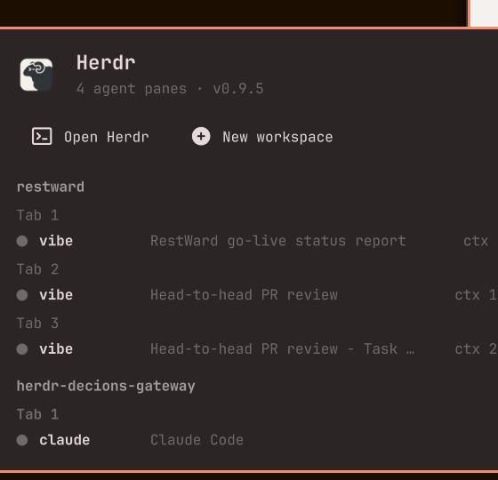

# jesper.herdr — Herdr bar widget for Omarchy

A bar widget and panel for [Herdr](https://herdr.dev/), the terminal workspace
manager for AI coding agents. It shows the live session — workspaces, tabs,
panes, the agent detected in each pane, and context usage — plus buttons to
open Herdr and create a new workspace.



## Install

Requires [herdr](https://herdr.dev/) installed, and Omarchy's default terminal
set (`omarchy default terminal ...`) for the "Open Herdr" button.

```bash
omarchy plugin add https://github.com/jeesondk/omarchy-herdr.git --enable
```

Then restart the shell (`omarchy restart shell`) if the widget does not appear
in the bar. Move it with `omarchy bar move jesper.herdr --section right`.

## What it shows

- Bar icon: the Herdr logo (from herdr.dev), dimmed when the herdr server is down.
- Panel: per workspace, its tabs, and each pane with a status dot, the agent
  running in it, the pane title, and context tokens (`ctx 48.6k`).
- Buttons: **Open Herdr** (runs `omarchy launch terminal herdr`) and
  **New workspace** (`herdr workspace create --focus`).

## How it works

The widget polls `bin/omarchy-herdr-state` (shipped in this repo, run with the
system python3) every `refreshIntervalSec` seconds (default 3; change with
`omarchy bar set jesper.herdr refreshIntervalSec 5`). The exporter reads
`herdr api snapshot` / `herdr agent list` over herdr's socket API.

Herdr only recognizes a fixed set of agents, so a pane running an agent it
doesn't know (e.g. `vibe-rs`) stays at status "unknown" in herdr itself. For
those panes the exporter falls back to `herdr pane process-info` to identify
the foreground agent process and reads context usage from the agent's own
status line (`herdr pane read`).

## Notes

- Unofficial community plugin; not affiliated with Herdr. The logo asset is
  Herdr's brand mark from herdr.dev.
- The plugin runs unsandboxed inside omarchy-shell; review the code before
  installing (as `omarchy plugin add` itself warns).

## License

MIT (see LICENSE). The Herdr logo remains property of its respective owner.
