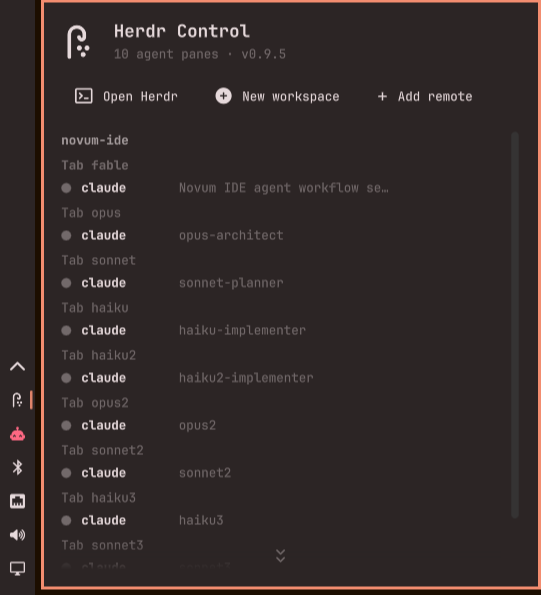

# Herdr Control — Herdr bar widget for Omarchy

Plugin ID: `io.github.jeesondk.herdr`

A bar widget and panel for [Herdr](https://herdr.dev/), the terminal workspace
manager for AI coding agents. It shows the live session — local and remote —
workspaces, tabs, panes, the agent detected in each pane, and context usage —
plus actions to open Herdr, attach to remotes, and create workspaces.



## Features

- Bar icon: a shepherd's crook herding three agents, in the theme's foreground
  colour, dimmed when the local herdr server is down.
- Panel: per workspace, its tabs, and each pane with a status dot, the agent
  running in it, the pane title, and context tokens (`ctx 48.6k`).
- **Open Herdr** — `omarchy launch terminal herdr` (attaches to the persistent session).
- **New workspace** — `herdr workspace create --focus`.
- **Remote machines over SSH** — see below.
- **Add remote** — inline `herdr machine add` flow with automatic terminal fallback.
- **Herdr desktop app terminals** — terminals run by the desktop app
  (herdr-core, `hc`) on this machine and on each remote, with click-to-attach.
  See below.
- The header (title and action buttons) stays put while the workspace lists
  scroll. When the panel overflows, a scroll bar and two stacked chevrons show
  there is more below (or above, once scrolled down); click the chevrons to
  scroll.

## Install

Requires [herdr](https://herdr.dev/) installed and running locally, and
Omarchy's default terminal set (`omarchy default terminal ...`) for the
"Open Herdr" / "Attach" buttons.

```bash
omarchy plugin add https://github.com/jeesondk/omarchy-herdr.git --enable
```

Then restart the shell (`omarchy restart shell`) if the widget does not appear
in the bar. Move it with `omarchy bar move io.github.jeesondk.herdr --section right`.

The plugin is fully self-contained: the state exporter ships in the repo at
`bin/omarchy-herdr-state` and is invoked from the plugin directory, so no
files outside `~/.config/omarchy/plugins/io.github.jeesondk.herdr/` are needed.

## What this plugin can access

Omarchy plugins are not sandboxed: the panel (`Panel.qml`) runs inside
`omarchy-shell` with your user's rights. The plugin limits what its own
helper can reach instead.

- **Local polling is sandboxed.** Every few seconds the exporter
  (`bin/omarchy-herdr-state`) asks the local herdr server for its state. Those
  `herdr` calls run inside [bubblewrap](https://github.com/containers/bubblewrap)
  with a read-only system, no network, an empty home directory, and only
  herdr's config folder (`~/.config/herdr`, where its socket lives) mounted
  read-only. They cannot read your SSH keys or other files, write anywhere, or
  reach the network.
- **Fallback.** If `bwrap` is not installed or user namespaces are disabled,
  the same calls run unsandboxed so the widget keeps working. The exporter's
  JSON output has a `sandboxed` field that says which happened; set
  `OMARCHY_HERDR_NO_SANDBOX=1` to turn the sandbox off.
- **Not sandboxed:** remote machines (herdr and `hc` are reached over your own
  SSH setup, which needs your SSH config, keys or agent, and the network), the
  saved-machine list, and the local `hc` call for desktop-app terminals.
- **Actions you click** run as you: opening a terminal
  (`omarchy launch terminal …`), creating a workspace, adding or removing a
  remote (`herdr machine add/remove`), and saving the `remotes` setting
  (`omarchy bar set …`).
- The plugin never uses `sudo`, downloads nothing, and writes nothing outside
  its own bar settings.

## Uninstall

```bash
omarchy plugin remove io.github.jeesondk.herdr
```

This removes the widget from the bar and deletes
`~/.config/omarchy/plugins/io.github.jeesondk.herdr/`. The plugin writes nothing outside
that folder and its own bar settings. Machines saved with **Add remote** are
herdr's own records and stay in `herdr machine list`; remove them from the
panel first, or with `herdr machine remove <id>`.

The optional vibe bridge now lives in its own repo,
[herdr-vibe-bridge](https://github.com/jeesondk/herdr-vibe-bridge); if you
installed it, remove it with the commands in its README.

## Settings

Widget settings live in the `io.github.jeesondk.herdr` entry in
`~/.config/omarchy/shell.json`; change them with `omarchy bar set`:

```bash
omarchy bar set io.github.jeesondk.herdr refreshIntervalSec 5   # poll interval, seconds (default 3)
omarchy bar set io.github.jeesondk.herdr remotes "hal,vps"      # remote machine labels to show (default "")
omarchy bar get io.github.jeesondk.herdr remotes
```

## Remote machines over SSH

Herdr can manage remote servers. Add one from the panel (**Add remote** →
`user@host` → **Add**), or manually:

```bash
herdr machine add hal.j2-consult.dk --label hal     # interactive: approves remote install, asks password if needed
omarchy bar set io.github.jeesondk.herdr remotes "hal"
```

Each remote section shows a status dot (red + "unreachable" when down), an
**Attach** button (opens the remote TUI via `herdr --remote <target>` in the
default terminal), a **New workspace** button (`herdr --machine <id>
workspace create --focus`), a trash button that removes the remote after a
confirm (`herdr machine remove <id>` plus dropping the label from `remotes`),
and the remote's live workspace tree.

Remote state is queried through `herdr --machine <profile-id> api snapshot`
(herdr proxies the socket API over SSH); the exporter resolves labels to
profile ids via `herdr machine list --json`, because a duplicated label makes
`--machine <label>` fail with "ambiguous" — if you hit that, remove the
duplicate with `herdr machine remove <id>`. Remote polls use a longer timeout
and never block the local section.

## Herdr desktop app (herdr-core)

The herdr desktop app doesn't run its terminals in the herdr server. They live
in herdr-core (`hc`), a separate daemon, so they never appear in the herdr TUI,
`herdr agent list`, or the workspace trees above. That includes agents started
with `hc run` / `hc send` from an agent session. The panel shows them anyway:

- For each remote, the exporter runs `hc ls --json` over SSH
  (`~/.local/bin/hc`, else `hc` on the remote's PATH). Locally it uses `hc` if
  it's installed. A host without `hc` simply has no desktop section.
- Terminals are grouped by their `where` label (`Workspace / tab`) under a
  "Herdr desktop app — click a terminal to attach" caption, with the same
  status dots and agent names (Claude Code shows as `claude`).
- **Click a terminal to attach**: it opens a terminal running
  `ssh -t <target> '<hc> attach <address>'` (or `hc attach <address>`
  locally). Detach with `ctrl+\`.

The SSH polls use their own control master
(`$XDG_RUNTIME_DIR/omarchy-herdr-ssh-%C`, kept for 10 minutes), so polling
every few seconds reuses a single connection. All hosts are queried in
parallel.

### Add-remote failure handling

The panel runs `herdr machine add <target> --label <host>` non-interactively.
That succeeds when SSH key auth works. When it fails for a reason only an
interactive terminal can resolve — SSH password/agent auth (`permission
denied (…password…)`), or herdr refusing to approve installing/updating the
remote herdr binary ("run from an interactive terminal to approve …") — the
panel detects it, adds the label to `remotes` immediately, and opens a
terminal running `herdr machine add` so you can enter the password / approve
the install. The section appears right away and turns green on the next poll
once the machine is saved. Other failures (DNS, host key) show the error with
an **Open in terminal** fallback button.

## How it works

The widget polls `bin/omarchy-herdr-state` (system python3) every
`refreshIntervalSec` seconds and renders the JSON it prints. The exporter
reads `herdr api snapshot` / `herdr agent list` over herdr's socket API, for
the local session and each configured remote, plus `hc ls --json` for the
desktop app's terminals on each host. Hosts are queried in parallel.

Herdr only recognizes a fixed set of agents, so a pane running an agent it
doesn't know (e.g. `vibe-rs`) stays at status "unknown" in herdr itself. For
those panes the exporter falls back to `herdr pane process-info` to identify
the foreground agent process, and reads context usage from the agent's own
status line (`herdr pane read`, e.g. `ctx 46.4k/800k`).

## Troubleshooting

- **Widget missing from the bar after edits:** run `omarchy restart shell`;
  if the icon looks stale, clear `~/.cache/quickshell/qmlcache` first.
- **QML edits don't show up:** the shell logs "Local plugin changed,
  reloading" on every save, but the running widget keeps its old QML until
  `omarchy restart shell`. Changes to `bin/omarchy-herdr-state` take effect
  on the next poll.
- **Agents you started don't appear under the workspace trees:** they're
  probably in the desktop app (started with `hc`). Look under the desktop
  section of that host, or start them with `herdr agent start` /
  `herdr agent prompt` so they run in the herdr server.
- **"Herdr server is not running" while herdr runs:** that line is the widget's
  initial state — it means the poll didn't run, not that herdr is down. Check
  the shell log for `io.github.jeesondk.herdr failed` / QML errors
  (`journalctl -b | grep omarchy-shell`).
- **QML errors after pulling updates:** `omarchy plugin validate
  ~/.config/omarchy/plugins/io.github.jeesondk.herdr` and `omarchy restart shell`.

## Notes

- Unofficial community plugin; not affiliated with Herdr. The icon is the
  plugin's own (`assets/icon.svg`).
- The plugin runs unsandboxed inside omarchy-shell; review the code before
  installing (as `omarchy plugin add` itself warns).

## License

MIT (see LICENSE).
